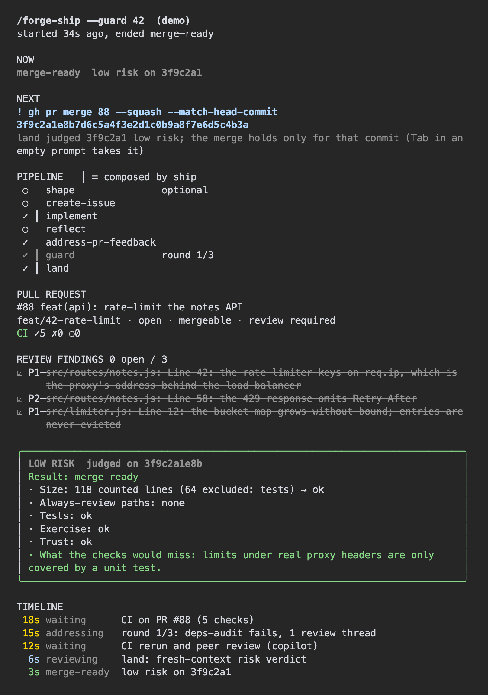

<p align="center">
  
</p>

<p align="center">
  <strong>Agent skills for structured development with pluggable issue tracking.</strong><br>
  One workflow. Ten skills. From idea to merged code.
</p>

<p align="center">
  <a href="#quick-start">Quick start</a> &middot;
  <a href="#how-it-works">How it works</a> &middot;
  <a href="#skills">Skills</a> &middot;
  <a href="docs/lens.md">Lens</a> &middot;
  <a href="docs/architecture.md">Architecture</a> &middot;
  <a href="#contributing">Contributing</a>
</p>

---

A forge is where raw material meets intention. You bring the codebase; these skills shape the workflow from issue to implementation to review.

---

<p align="center">
  
</p>

## Quick Start

Install forge one way per machine:

```
# Claude Code: the skills plus the lens above
/plugin install forge --marketplace mgratzer/forge
```

```bash
# any other agent that reads Agent Skills
npx skills add mgratzer/forge
```

Then, in your project:

```
/forge-setup-project       # once per repo: AGENTS.md and the docs agents work from
/forge-ship 42             # implement Issue #42, review it in fresh context, open the PR
/forge-ship --guard 42     # and keep going: CI, review feedback, then a risk verdict
```

With the plugin, the commands are namespaced (`/forge:forge-ship`), and `/forge demo` replays a guarded run in the lens without touching GitHub.

## How It Works

```
forge-setup-project → [forge-shape →] forge-create-issue → forge-implement → forge-reflect → forge-address-pr-feedback → forge-guard → forge-land
                                                                        ╰──── forge-ship ────╯╰────────── forge-ship --guard ───────────╯
```

**Ship** implements a change from an Issue, a plan file or a description: it researches the codebase, works in vertical phases with tests, runs the app on the changed path when the project says how, and opens a PR. A fresh-context reviewer, not the session that wrote the code, reviews the diff before you see it.

**Guard** drives the open PR to review-ready without anyone watching: a simplification pass, a security pass when the diff calls for one, CI, the peer reviewer, and feedback in bounded rounds. It never merges.

**Land** judges a green PR's risk on its head commit and writes the verdict into the PR. Low risk means you can merge without reading the diff; anything else comes with a list of where to look. It merges by itself only when the project opts in.

Issues live wherever you keep them: GitHub, a markdown `plan/` folder in the repo, or a tracker you declare in `AGENTS.md`. For many Issues at once, `forge-batch` groups them into Waves that can ship in parallel; see [Unattended Shipping](docs/unattended.md).

## Skills

| Skill | Command | Purpose |
|-------|---------|---------|
| Setup Project | `/forge-setup-project` | Set up or audit a project's context for agentic engineering |
| Shape | `/forge-shape` | Shape a vague idea into a clear plan, one question at a time |
| Create Issue | `/forge-create-issue` | Plan and create Issues (GitHub, markdown, or another provider) |
| Implement | `/forge-implement <input>` | Implement from an Issue, plan file, or description, and open the PR |
| Reflect | `/forge-reflect` | Self-review changes: a PR, a branch, or uncommitted work |
| Address PR Feedback | `/forge-address-pr-feedback` | Address unresolved review threads |
| **Ship** | **`/forge-ship <input>`** | **Implement and review in one go; `--guard` continues through guard and land** |
| Guard | `/forge-guard [pr]` | Drive an open PR to review-ready; never merges |
| Land | `/forge-land [pr]` | Judge a green PR's risk: merge-ready, or review-ready with where to look |
| Batch | `/forge-batch <scope>` | Group Issues into Waves that can ship concurrently; `--start` starts the ready ones |

Every skill takes optional trailing guidance: `/forge-ship 42 -- keep the diff minimal`.

## The Lens

The Claude Code plugin adds the lens: a pane beside the session that follows a forge run. It shows the current state and the command that most likely comes next, the pipeline step, the PR's CI and review state, review findings as a checklist, and the risk verdict, which it marks stale once the PR moves past the judged commit. A status line, a next-step suggestion you take with Tab, and a notification when a run ends or needs you come with it.

`/forge` says where a run is and what to do next, and `/forge config` shows the project's unattended settings with their defaults filled in. The lens only reads what the skills already print, so the skills work the same without it. See [Lens](docs/lens.md).

## Install Details

**Claude Code plugin.** `/plugin install forge --marketplace mgratzer/forge` brings the skills and the lens. The plugin tracks commits on `main`: update with `claude plugin update forge@forge`, or turn on auto-update for the marketplace under `/plugin`.

**npx skills.** `npx skills add mgratzer/forge` detects your agents and installs the skills to each of them ([skills.sh](https://skills.sh)).

**Manual.** Symlink the skills into your agent's skills directory:

```bash
ln -s /path/to/forge/skills/forge-* <your-agent-skills-dir>/
```

Each skill reaches the shared modules through its own `_shared` symlink, so nothing else needs installing. Use one channel per machine: with both the plugin and npx, Claude Code lists every skill twice.

## Contributing

Forge's skills are Markdown prompts that follow the [Agent Skills](https://agentskills.io) standard; the lens is TypeScript that Claude Code runs itself. [`AGENTS.md`](AGENTS.md) holds the principles and commands, and CI checks every pull request:

```bash
scripts/check-skills.sh                            # skill structure
npx @biomejs/biome@2.6.2 check --write .           # lint and format the lens
claude plugin validate . && claude plugin test .   # plugin manifests and lens tests
```

Test a skill change by invoking it on a real project, and use conventional commits (`feat(skills): add a skill`).

| Document | Purpose |
|----------|---------|
| [Context](CONTEXT.md) | Shared vocabulary used across the skills |
| [Architecture](docs/architecture.md) | Skill workflow, operating constraints, design decisions |
| [Development](docs/development.md) | Creating and modifying skills |
| [Coding Guidelines](docs/coding-guidelines.md) | Skill and role file format, authoring conventions |
| [Testing](docs/testing.md) | Automated checks and validating skills by hand |
| [PR Workflow](docs/pr-workflow.md) | Commits, PRs, branch naming, review |
| [Unattended Shipping](docs/unattended.md) | Guard loop, Waves, launchers, project setup |
| [Lens](docs/lens.md) | The Claude Code plugin and the lens |

## License

[MIT](LICENSE)
