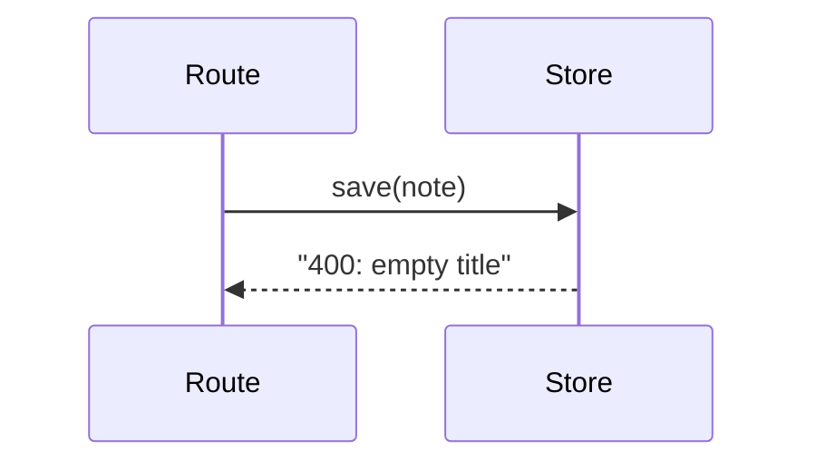

# Visuals

How a skill shows the shape of a change so a person can take it in at a glance: in a Plan, an Issue, a breakdown, or a PR's Change Outline.

## When

Draw a view only when it explains something the text or the diff doesn't, and let it replace the prose that said the same thing. A one-file fix, a rename, or a change one sentence explains gets no view. Never add one to fill a section.

## Where

What a reader sees decides the form, so a view has to work where it is read first:

| Read in | Use |
|---------|-----|
| A Plan or a `forge-shape` summary | Text views only. A person may read these in a terminal, and a Plan is copied verbatim into the PR, so it never holds Mermaid |
| A PR or Issue body on a host that renders Mermaid (GitHub, GitLab) | Text views, or Mermaid when parts interact |
| Anywhere else (a `plan/` folder, another tracker) | Text views only |

## Which

| View | Use for |
|------|---------|
| File tree | Which files own what; a shallow `tree`-style listing with a note per changed file |
| Call tree | How control flows through the changed path, important calls only |
| Contract | Endpoint shapes, schemas, message formats, public signatures |
| Pseudocode | Changed logic, in plain words rather than code |
| Matrix | One rule restated in several places; a table with a row per rule, a column per file, and the line in each cell |
| Dependency order | Which pieces come first; a tree under each blocker, with `also blocked by` where a piece has two |
| Relationship (Mermaid) | Sequences, state, and data flow between parts, when they are too tangled for a call tree |

Use `diff` blocks (`+` added, `-` removed, a space for unchanged context) when the shape already exists, and show the full target shape when most of it is new.

```diff
 src/
 ├── notes/
 │   ├── store.ts        # changed: writes go through validate()
+│   └── validate.ts     # rejects empty titles
 └── routes.ts
```

```text
1 feat(api): store drafts
├─ 2 feat(ui): show the draft banner
└─ 3 feat(ui): restore a draft
   └─ 4 feat(ui): discard a draft (also blocked by 2)
```

````markdown

````

## How

- **Compare like with like.** Before and after use the same view, so the difference is what stands out. A Mermaid view shows the target, or two labelled diagrams when the interaction itself changes.
- **Use real names.** Draw from code you have read: every file, function, and line in a view exists, or is one the change adds. Use `CONTEXT.md` terms for concepts.
- **Redraw rather than explain.** One line of text before a view is enough; a view that needs a paragraph is the wrong view.
- **Keep Mermaid small.** About 10 nodes, with quotes around any label holding punctuation. Nothing validates it, and a syntax error renders as an error box in place of the diagram.
